# nopekit

<p align="center">
<picture>
  <source media="(prefers-color-scheme: dark)" srcset="docs/img/nopey.png">
  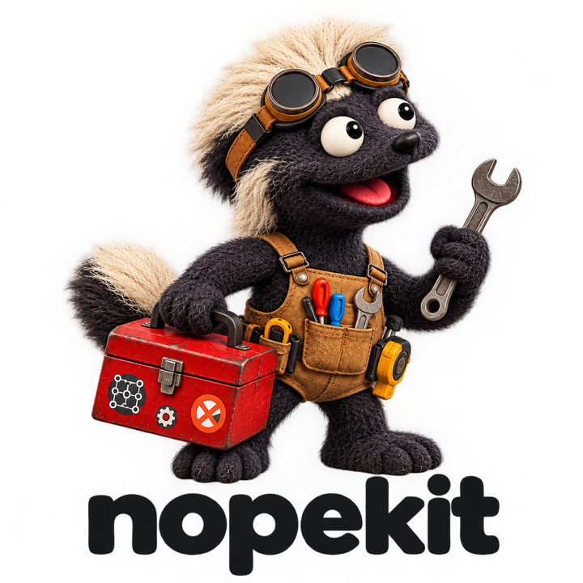
</picture>
</p>

## What Is Nopekit?

**Nopekit gives your AI agent engineering checks that can say “nope.”** It's a plugin for Claude Code, Codex and Cursor that helps you turn an idea into a physical design, test it against math, physics and engineering tools, and see what still needs work.

It's based on the [Grounding by Falsification](https://github.com/neuman/nopekit/blob/main/grounding_by_falsification.pdf) approach. AI has gotten very good at making believable proposals for all sorts of things both digital and physical but it is especially good at coding. The problem is that it's still not great at figuring out which proposals are actually good on its own. Grounding by falsification is the idea that we need to wrap AI with something outside itself that can check its work and say "nope" using trusted reasoning/math/physics/etc. Nopekit turns that approach into an extensible framework with room for plugins that can falsify proposals across any domain but especially physical design work.

**You describe what you want. The agent proposes a design. Independent checks try to break it.** Nopekit records the results and the reasons behind each design choice, then shows them on a project site. When the design changes, affected results become stale until checked again. Assumptions and tests that need a real prototype stay visible.

For example: “This shelf must carry 10 kg” becomes a load and a deflection limit. The agent designs a bracket; a beam check rejects it if it sags too far; a printability check rejects walls that are too thin. You can follow what failed, what changed, and why the next candidate is better.

[See It In Action](#see-it-in-action) · [Built In Packs](#built-in-packs) · [External Packs](#external-packs) · [Getting Started](#getting-started)

## See It In Action

**[PETGasus](https://neuman.github.io/PETGasusDrone/) is a quadcopter with a frame designed to print in one piece.** Its project site connects the design you can see with the requirements, decisions and evidence behind it.

[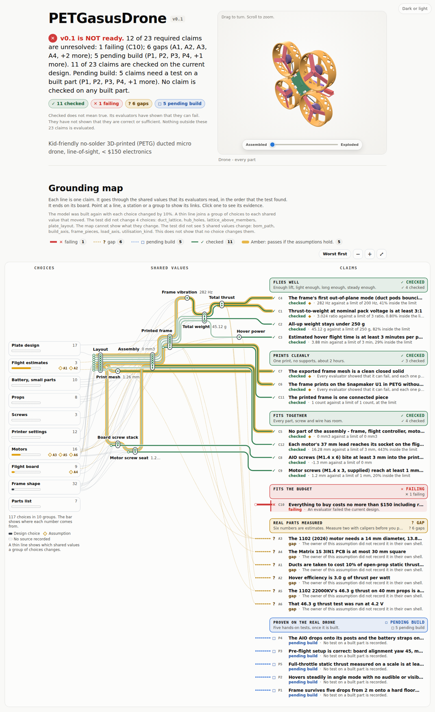](https://neuman.github.io/PETGasusDrone/)

[**Explore the live site →**](https://neuman.github.io/PETGasusDrone/) · [**Read the project repository →**](https://github.com/neuman/petgasusdrone)

The design history includes disconnected frames, thin walls and a frame that sagged far more than its optimizer predicted. Those rejected candidates are part of the record. The site shows what passed, what failed and what still waits on a physical build.

For smaller starting points, explore the [bracket example](examples/bracket/README.md), which runs without extra dependencies, or the [motorcycle airflow example](examples/motorbike/README.md), which uses OpenFOAM and ParaView.

## Built In Packs

Packs give the agent tools for a domain. A **proposer** makes a candidate; a **falsifier**, called a **gate**, checks it. One design can use several packs: a drone frame needs structural, printing, geometry and cost checks.

**Falsifiers**

These eleven packs ship with Nopekit. The images show designs, results or illustrations of what each pack can check; click a pack name for its gates, sources, setup and limits.

| Example | Pack and what it checks | Basis and sources |
|---|---|---|
| 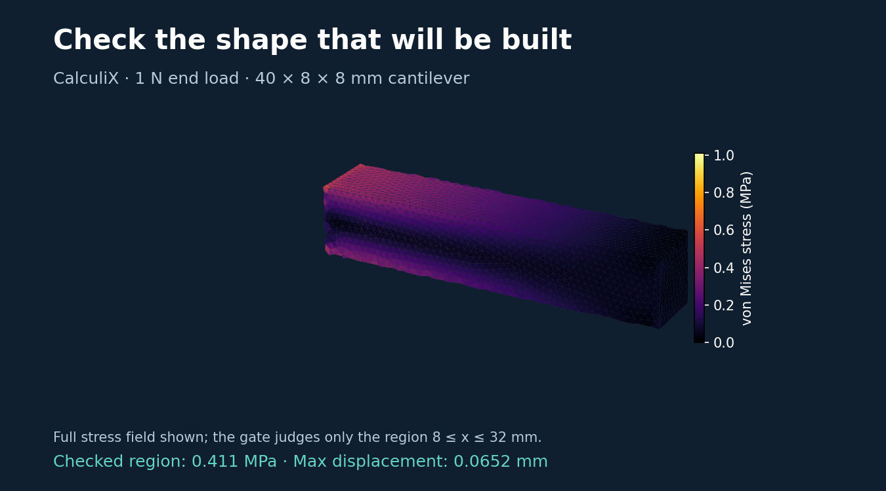<br>Check the exported shape with a different solver | [**topology-simp**](packs/topology-simp/PACK.md) · 4 gates<br>Material volume, static displacement and stress in a stated region. CalculiX meshes the exported STL independently of the optimizer; checks include mesh refinement and load equilibrium. | **3 established · 1 model-only**<br>trimesh and CalculiX results, with model-input guards. Requires trimesh, NumPy, Gmsh and CalculiX 2.21. Linear isotropic static checks; printing and physical tests remain separate. |
| 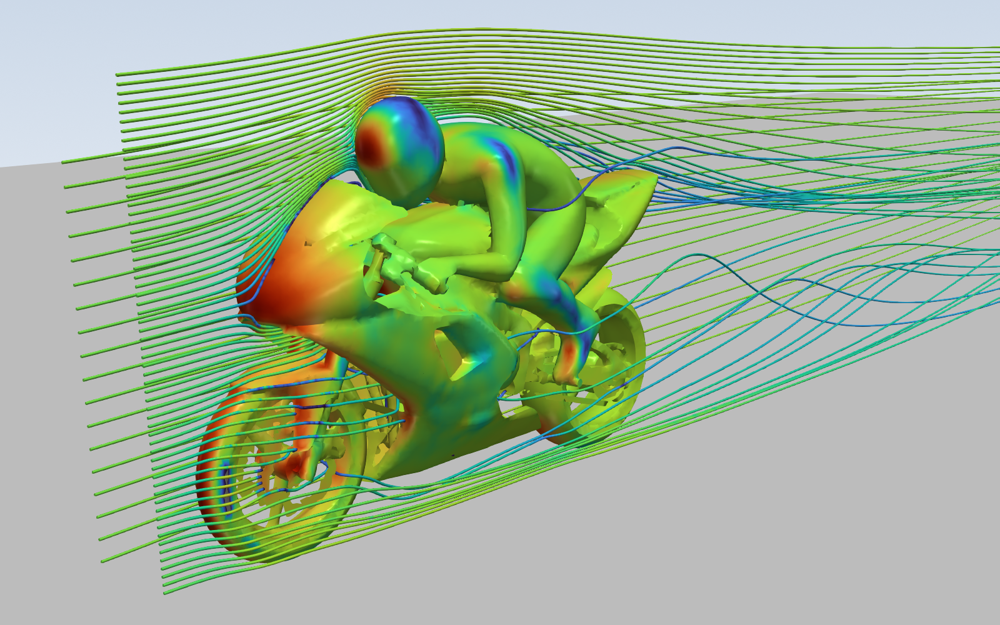<br>Air around a motorcycle and rider | [**aero-openfoam**](packs/aero-openfoam/PACK.md) · 9 gates<br>Drag, mesh quality, convergence and wall treatment for turbulent external flow. The motorcycle example's drag claim is still unresolved. | **3 established · 4 sourced · 2 model-only**<br>OpenFOAM; published domain, convergence and grid-error methods. Needs ESI OpenFOAM v2606; ParaView 6.2 for pictures. |
| 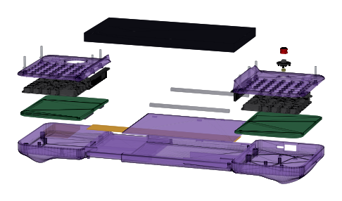<br>Do all these parts fit together? | [**cad-solid**](packs/cad-solid/PACK.md) · 7 gates<br>Closed solids, collisions, wall thickness and whether every part is held in the assembly. | **1 established · 6 model-only**<br>trimesh's volume verdict; Nopekit's geometry checks. Needs trimesh and NumPy. |
| 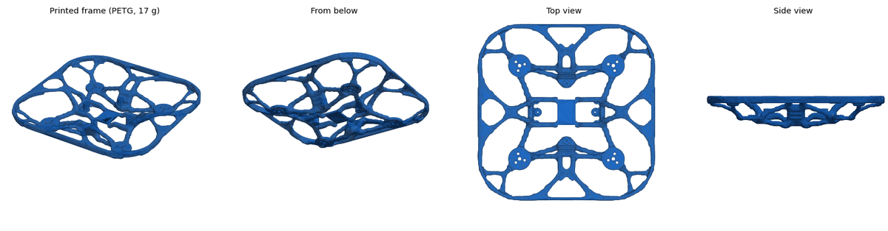<br>A drone frame designed to print in one piece | [**fdm-print**](packs/fdm-print/PACK.md) · 7 gates<br>Thin walls, overhangs, bridges, bed fit, layer direction and estimated print time. | **7 model-only**<br>Printing heuristics with documented thresholds. Mesh checks need trimesh and NumPy. A pass still needs a real print. |
| 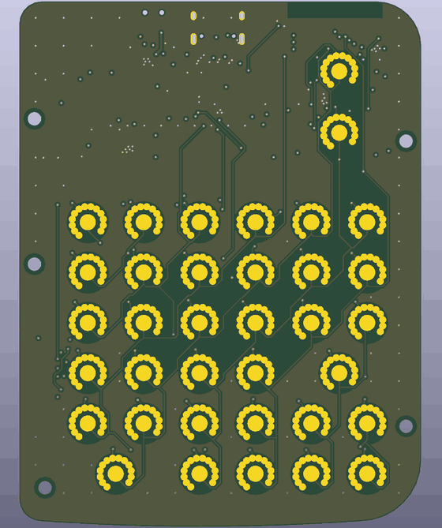<br>Check the board the router produced | [**pcb-kicad**](packs/pcb-kicad/PACK.md) · 10 gates<br>Design rules, open connections, schematic agreement, trace heating, circuit simulation and enclosure fit. | **6 established · 3 sourced · 1 model-only**<br>KiCad, ngspice and CadQuery; IPC-2221 and fabricator limits. A clean rule check does not establish a correct circuit. |
| 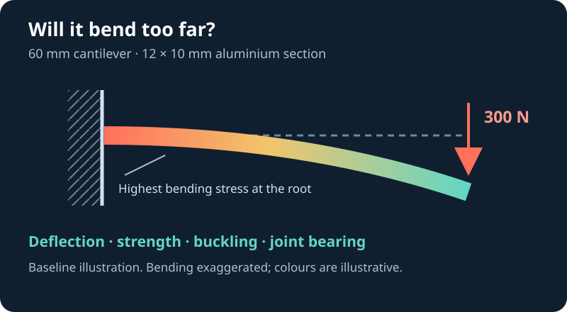<br>Beam-pack baseline, illustrated | [**beam-analytic**](packs/beam-analytic/PACK.md) · 8 gates<br>Bending, sag, buckling, shear and fastener bearing, with guards on where beam theory applies. | **7 sourced · 1 model-only**<br>Standard strength-of-materials formulae. No extra dependencies. Applies to beam-like members, not arbitrary meshes. |
| 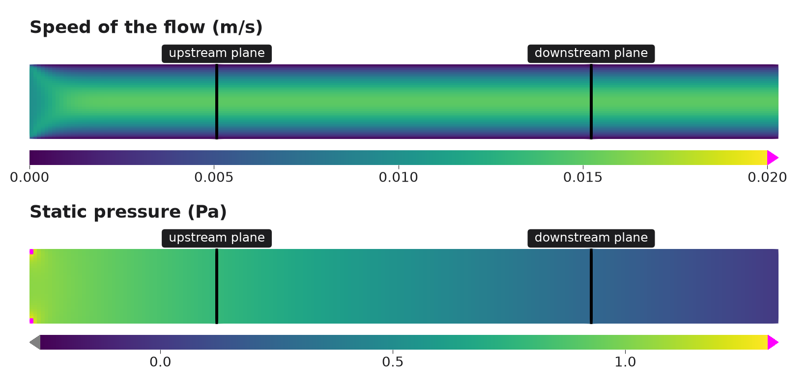<br>Pressure loss through an oil channel | [**cfd-openfoam**](packs/cfd-openfoam/PACK.md) · 6 gates<br>Laminar pressure drop after checking flow regime, mesh quality, convergence and mesh independence. | **3 established · 2 sourced · 1 model-only**<br>OpenFOAM and published grid-convergence methods. Needs ESI OpenFOAM v2606; ParaView 6.2 for pictures. |
| 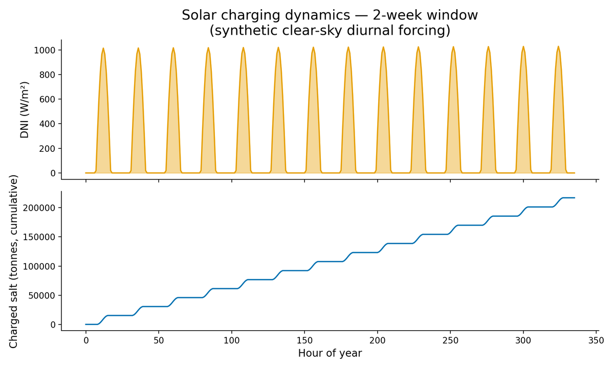<br>Solar charging over two weeks | [**thermal-analytic**](packs/thermal-analytic/PACK.md) · 10 gates<br>Heat loss, cooling, temperature, fins, solar collection and stagnation. | **9 sourced · 1 model-only**<br>Heat-transfer correlations; Duffie & Beckman and ASHRAE solar models. No extra dependencies. |
| 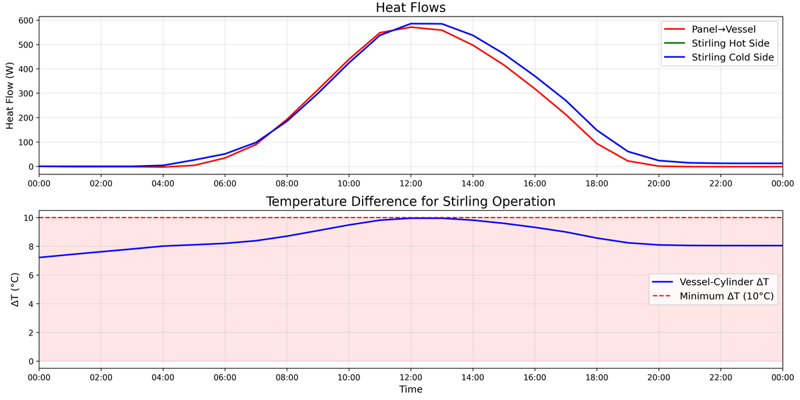<br>A solar Stirling system over a day | [**openmodelica**](packs/openmodelica/PACK.md) · 8 gates<br>Equation balance, compilation, simulation completion and simulated values against their limits. | **4 established · 4 model-only**<br>OpenModelica's own checks and results, plus source and consistency checks. Solver gates need `omc`. |
| 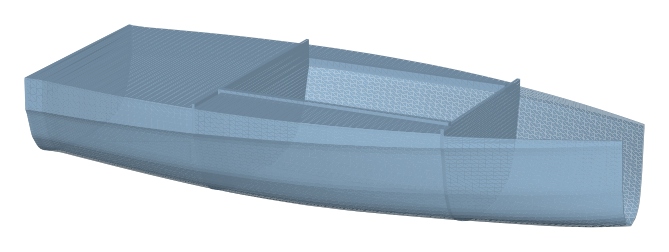<br>A hull that must float and stay upright | [**fluids-analytic**](packs/fluids-analytic/PACK.md) · 7 gates<br>Buoyancy, freeboard, stability, drag and pipe pressure loss. | **7 sourced**<br>Textbook hydrostatics and flow correlations, within their stated regimes. No extra dependencies. |
| 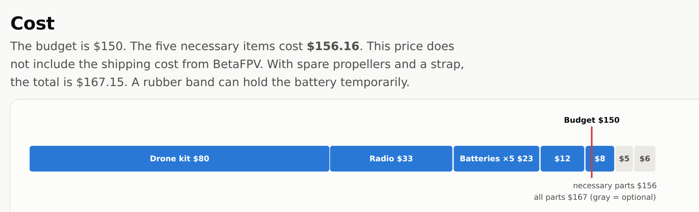<br>The whole build against its budget | [**sourcing**](packs/sourcing/PACK.md) · 7 gates<br>Missing prices, cost overruns, lead times, minimum orders and single-source parts. | **1 sourced · 6 model-only**<br>Vendor process rules and procurement checks on your recorded bill of materials. Offline; no live stock search. No extra dependencies. |

**How much should you trust a check?** Each gate declares where its logic comes from:

- **Established:** an existing tool's own verdict, such as KiCad's design-rule check. Trust extends as far as that tool and the problem you gave it.
- **Sourced:** a formula or rule from a cited textbook, standard or datasheet. Trust depends on the source and its range of applicability.
- **Model-only:** logic without an independent source. Its controls show it can fail; they do not establish that its reasoning is correct.

Before a gate's passes count, it must pass a known-good input and reject a known-bad one. That qualification is separate from its basis. **Skipped, crashed and stale checks never count as passes.** The report shows both the outcome and the basis so you can judge the evidence.

**Proposers**

The agent itself is the everyday proposer, writing and changing your design. Built-in packs also ship dedicated proposal tools:

| Example | Proposer | Tool and trust |
|---|---|---|
| 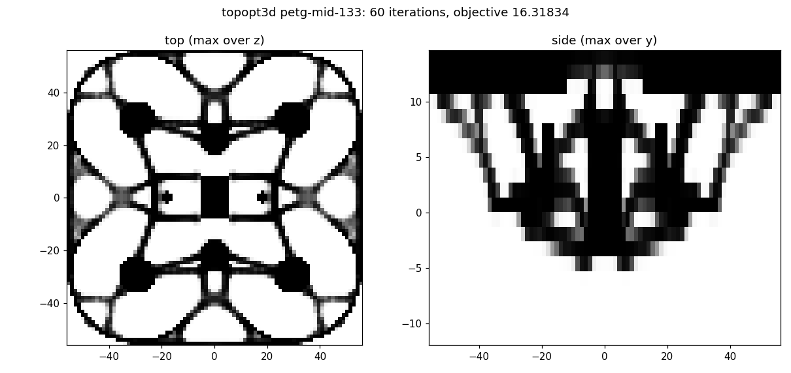<br>Find where the material earns its weight | [**topology-simp: 3D topology optimization**](packs/topology-simp/PACK.md)<br>Give it loads, supports, keep-outs and a material budget. SIMP proposes a 3D density field for your model to turn into a part. | **Sourced:** SIMP, density filtering and projection from published methods. Extracted from PETGasus. NumPy, SciPy and Numba; pyamg for larger solves. Its own score is a proposal, never structural proof. |
| <br>Routed keyboard board | [**pcb-kicad: autoroute**](packs/pcb-kicad/PACK.md)<br>Turn an unrouted KiCad board into a routed candidate. | **Freerouting**, an established autorouter. Its output is a proposal; KiCad gates check the adopted board. Requires pcbnew, Java and Freerouting. |

## External Packs

**A pack can live in its own Git repository.** You can share domain knowledge, wrap another engineering tool, or keep a project's custom checks alongside its design without changing Nopekit itself.

A standalone pack has a `pack.json` manifest, a `PACK.md` explaining its scope, and the gates, proposers, references and test fixtures it needs. Clone it into your project's `.nopekit/packs/<pack-name>/`, or into `~/.nopekit/packs/<pack-name>/` to make it discoverable across projects. `NOPEKIT_PACK_PATH` can point to other directories containing packs.

Then enable it by the name in its manifest:

```sh
nopekit packs list
nopekit packs validate <pack-name>
nopekit packs add <pack-name>
nopekit gate selftest --pack <pack-name>
```

`packs add` enables a discovered pack for the current project; cloning and updating its repository are separate steps. External gates also face mutation checks: Nopekit perturbs values from their known-good inputs to test whether the gates reject violations.

External packs can add specialized falsifiers, such as a product's crash or vibration tests, and proposal tools for domains the built-in packs do not yet cover.

To build your own, ask the agent to use Nopekit's **pack-authoring** skill. The [pack format](docs/PACK_FORMAT.md) defines the interface and the [extension protocol](docs/EXTENSION_PROTOCOL.md) explains how to develop and qualify a new capability.

## Getting Started

### 1. Install Nopekit

Nopekit is one plugin for three agents: the repository root holds a manifest for each
(`.claude-plugin/`, `.codex-plugin/`, `.cursor-plugin/`), and they share the same skills
and the same end-of-turn hook, which records each round.

**Claude Code.** Ask it:

> Install the Nopekit plugin from `https://github.com/neuman/nopekit` and help me get it ready to use.

Or install it directly with Claude Code's plugin commands:

```text
/plugin marketplace add neuman/nopekit
/plugin install nopekit
```

**Codex.** Codex reads the same marketplace:

```bash
codex plugin marketplace add neuman/nopekit
codex plugin add nopekit@nopekit
```

Codex runs a plugin's hook only after you review and trust it, and asks again after
every update of the plugin. Until you do, rounds are not recorded at the end of a turn;
`nopekit round --commit` records one by hand.

**Cursor.** Clone the plugin into Cursor's local plugins, then restart Cursor:

```bash
git clone --depth 1 https://github.com/neuman/nopekit ~/.cursor/plugins/local/nopekit
```

To update, `git -C ~/.cursor/plugins/local/nopekit pull` and restart. Cursor can also
import the Claude Code plugin; install it one way, not both, or each turn ends with two
rounds.

You'll need Python 3.10 or newer available as `python3`. Nopekit's core has no third-party Python dependencies. Some checks need optional tools or packages; the agent should tell you when one is needed. For mesh checks used in 3D printing and solid-part work, install:

```sh
pip install trimesh numpy
```

### 2. Bring an idea

Open your agent in a project directory and say:

> I want to use Nopekit to design something new. Interview me about the idea, one question at a time. Help me turn what I want into requirements, explore possible designs, set up the project and its checks, and launch the project site so I can understand the design and follow its progress.

You can start with an empty folder, a sketch, existing CAD files or a half-finished design. The agent helps choose the relevant packs and explains any tools they need.

## Using Nopekit Step By Step

You work through this in conversation. The agent operates the tools; the project site lets you follow the work and question its conclusions.

1. **Describe the thing you want.** Say what it does, where it goes and what matters: size, load, price, materials, power or feel. The agent helps make those requirements concrete.
2. **Decide what would count as success.** Turn requirements into testable claims: “sags no more than 0.5 mm,” “fits this printer,” “costs under $150.” Identify which need calculations, simulations, measurements or human judgment.
3. **Explore candidates.** The agent builds the model or runs a proposer. It records the choices, their reasons and the alternatives that lost, so the next iteration can build on what you learned.
4. **Run checks and inspect failures.** Gates compare the candidate with its limits. Follow the evidence on the site, challenge assumptions, change the design and run again. A missing solver stays visible as a skipped check.
5. **Review what is ready.** The report separates current checks from assumptions, unresolved claims and physical tests. Changing the design invalidates affected evidence. Each milestone names what must be established before you spend on a prototype or fabrication.
6. **Build, measure and feed the results back.** Export reruns the required checks before producing a package. Record what happened to the real article; a physical failure becomes evidence for the next design. A simulation pass alone never establishes how the built object behaves.

<details>
<summary>Useful commands when you want to inspect the project directly</summary>

| Command | What it tells you or does |
|---|---|
| `nopekit status` | Current claims and their statuses. |
| `nopekit check` | Run the project's gates. |
| `nopekit report` | Readiness and the evidence behind it. |
| `nopekit why <name>` | Why a parameter, claim, requirement or decision is there. |
| `nopekit gap --propose` | Missing evidence and packs that might help. |
| `nopekit doctor` | Diagnose the environment, model and records. |
| `nopekit site serve --watch --detach` | Open a local server that watches project changes. |
| `nopekit site serve --stop` | Stop the detached server. |
| `nopekit --help` | All commands and options. |

</details>

## More Detail

- [The method](METHOD.md) — the principles Nopekit makes mechanical.
- [Pack format](docs/PACK_FORMAT.md) — gates, proposers, controls and source declarations.
- [Extension protocol](docs/EXTENSION_PROTOCOL.md) — developing new capabilities.
- [Site contract](docs/SITE_CONTRACT.md) — how the site represents designs and evidence.
- [Spine contract](docs/SPINE_CONTRACT.md) — the engine, records and its limits.
- [Origins](docs/ORIGINS.md) — the experience behind the method.
- [Grounding by Falsification paper](grounding_by_falsification.pdf) — the underlying approach.
- [Contributing](CONTRIBUTING.md) — working on Nopekit itself.

## Status and License

Nopekit is an early project. The core engine and bundled packs work, but interfaces may change and the range of supported checks is still growing. Use it, inspect it, fork it, and tell us what breaks.

Licensed under the [Apache License 2.0](LICENSE).
