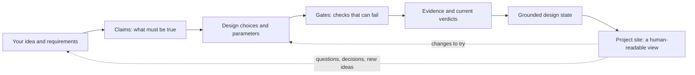

# nopekit

<p align="center">
<picture>
  <source media="(prefers-color-scheme: dark)" srcset="docs/img/nopey.png">
  
</picture>
</p>

**Have an idea for a real thing? Let's find out what holds up.**

Nopekit is a Claude Code plugin for exploring and engineering physical designs with an AI agent. Tell it what you want to make. It helps you work out what the design needs to do, explore possible approaches, build and run checks, and keep track of what the evidence actually says as the design changes.

It's based on the [Grounding by Falsification](grounding_by_falsification.pdf) approach. AI has gotten very good at making believable proposals for all sorts of things both digital and physical but it is especially good at coding. The problem is that it's still not great at figuring out which proposals are actually good on its own. Grounding by falsification is the idea that we need to wrap AI with something outside itself that can check its work and say "nope" using trusted reasoning/math/physics/etc. Nopekit turns that approach into an extensible framework with room for plugins that can falsify proposals across any domain but especially physical design work.

You don't need to learn a new engineering framework before you start. Install the plugin, open a conversation, and bring your idea. The agent will work through the process with you.

<p align="center">

</p>

<p align="center">
<a href="https://neuman.github.io/PETGasusDrone/">PETGasus live site</a> · <a href="https://github.com/neuman/petgasusdrone">PETGasus repository</a>
</p>

*An example project site. It shows the design, the current candidate, the claims that matter, and how those claims connect to the choices and checks behind them.*

## Get started

### 1. Install Nopekit in Claude Code

If you're already using Claude Code, start by asking it:

> Install the Nopekit plugin from `https://github.com/neuman/nopekit` and help me get it ready to use.

Or install it directly with Claude Code's plugin commands:

```text
/plugin marketplace add neuman/nopekit
/plugin install nopekit
```

You'll need Python 3.10 or newer available as `python3`. Nopekit's core has no third-party Python dependencies. Some checks need optional tools or packages; the agent should tell you when one is needed. For mesh checks used in 3D printing and solid-part work, install:

```sh
pip install trimesh numpy
```

### 2. Start a project

Open Claude Code in an empty directory and start with a prompt like this:

```text
I want to use Nopekit to design something new. Interview me about the idea, one question at a time. Help me turn what I want into requirements, explore possible designs, set up the project and its checks, and launch the project site so I can understand the design and follow its progress.
```

Then have a conversation. You can bring a rough idea, a half-finished project, a sketch, or a folder of existing files. You don't need to arrive with a complete specification.

### 3. Follow the work in the project site

As the project takes shape, Nopekit starts a local site for the project. Open the URL Claude Code gives you. The site is the human-readable surface of the project's **grounded design state**: it helps you see what you're trying to build, what alternatives are in play, which candidate is current, and why that candidate is or isn't ready.

Keep talking with the agent, question its conclusions, change your mind, and try alternatives. The design and its evidence evolve together.

---

## What Nopekit is for

AI can generate design ideas quickly. The hard part is finding out which ones survive contact with reality—and keeping track of what you learned when the design changes.

Nopekit helps you explore a **space of possible designs**, not just produce one plausible-looking answer. It records the requirements, the choices and parameters that shape the design, the claims that need to hold, the checks used to evaluate those claims, and the evidence those checks produce. When an input changes, choices and results that depended on it can become stale so the agent knows to reexamine them.

## A concrete example: PETGasus

[PETGasus](https://neuman.github.io/PETGasusDrone/) is a useful example of the kind of iterative design process Nopekit is meant to support. Its [project repository](https://github.com/neuman/petgasusdrone) shows the work behind a 3D-printed drone design.

The point isn't just to get a model that looks right. A design has to fit its requirements; its parts and parameters affect one another; and checks can reveal that a candidate fails, that an assumption needs attention, or that more evidence is needed. As the design changes, the reasons for the current choices should remain understandable.

That is the goal of Nopekit: to help the human and agent work through design, evaluation, and evidence together, rather than treating a generated artifact as the end of the job.

## How the pieces fit together

A Nopekit project connects what you want to make with the evidence needed to judge whether a candidate is ready.



The real project is interconnected: one choice can affect several values, claims, and checks, and one claim can depend on several choices. The diagram above is just a simplified way to orient yourself.

- **Requirements** capture what you asked for, in your own terms.
- **Claims** describe things that must be true for the design to meet those requirements.
- **Parameters and decisions** describe the choices that shape the candidate, including why a value was chosen and what alternatives were rejected.
- **Gates** are executable checks that evaluate claims. A gate must show that it can fail on a known-bad input before its result can count as qualified evidence.
- **Evidence and verdicts** record what happened when a gate ran, what inputs it used, and whether that result still applies to the current design.
- **The grounded design state** is the connected record of the design, its alternatives, dependencies, checks, and evidence.
- **The project site** is where that state becomes understandable to a person. It presents the project's intent, tradespace, current candidate, and the reasons it is or isn't ready. It doesn't replace the underlying evidence or decide that a design is true; it renders the project's recorded state so you and the agent can reason about it.

## Using Nopekit, step by step

You don't have to manually run every step. Claude Code and Nopekit work through the cycle with you; this section explains what you're likely to see and how to make sense of it.

### 1. Start with the thing you want to make

Describe the goal in everyday language. It helps to say what the thing is for, where it will be used, what it needs to fit, what it must survive, and what matters most to you. You can add details later.

The agent may ask for supporting material: sketches, photos, measurements, existing parts, links, datasheets, or examples of something similar. Share what you have; gaps can be made explicit rather than filled with invented certainty.

### 2. Turn the idea into requirements and claims

The agent helps turn your answers into requirements, then identifies claims that need to hold for a design to work. Review the requirements when it asks. Correct misunderstandings early: the goal is to preserve your intent, not to make the project fit the first interpretation the model came up with.

Some claims can be checked analytically. Others need a simulation, an external tool, a human judgment, or a physical build. Nopekit should keep those differences visible.

### 3. Explore candidates and record decisions

The agent works with you to develop the model and explore alternatives. The project should preserve not just the current choice, but useful context about why it was chosen and what was rejected. That helps a future iteration avoid repeating the same dead ends—and makes it easier to revisit an old option when its assumptions change.

You can still change your mind. The goal isn't to lock you into an early decision; it's to make the consequences of a change easier to see.

### 4. Run checks and read the results

A check, or **gate**, evaluates a specific claim against the current inputs. Results are recorded with their provenance. A result may be useful without being a pass: it can reveal a failure, expose a missing capability, or show that an earlier result is now stale.

Here are the important distinctions:

| Status | What it means |
|---|---|
| **Checked** | A qualified gate passed on the inputs that apply to the current candidate. This is evidence for the claim the gate tests—not a guarantee that the whole product works. |
| **Failing** | A gate found a problem with the current candidate. Use the detail to decide what to change or investigate. |
| **Gap** | No suitable qualified gate currently settles the claim. The claim remains unresolved. |
| **Open** | A gate exists, but hasn't produced a current result for the inputs. |
| **Stale** | A gate passed earlier, but something it depended on has changed. The old result doesn't establish the claim for the current candidate. |
| **Skipped** | The gate was skipped, often because a required tool or dependency is missing. Nothing was established by that run. |
| **Skipped (errored)** | The gate crashed. Treat the result as unresolved, not as a pass. |
| **Pending build / physical** | The claim needs evidence from building or testing the real thing. Software checks cannot substitute for that evidence. |
| **Assumed** | The project is relying on something that has not yet been established by a qualifying check. |

The key habit is to ask: **What exactly does this result establish, and what does it leave open?** A clean CAD check isn't proof that a physical part will behave as intended. A simulation result isn't a real-world measurement. A claim with no check isn't checked just because the design looks plausible.

### 5. Use the site to reason about the design

The site isn't just a progress dashboard or a picture of the model. It's a way to inspect the relationships inside the grounded design state.

Depending on the project and the views it provides, use it to:

- understand the project's intent and requirements;
- explore the available design choices and how they connect;
- inspect the current candidate and its representation;
- trace a claim through the values and choices it depends on to the gate that evaluates it;
- see why the candidate is ready, not ready, or ready only in a limited sense;
- spot failures, missing checks, stale results, and assumptions that need attention.

The site renders the recorded state; it doesn't independently verify the design. If a number or claim looks wrong, follow it back to the underlying record or evidence and work with the agent to correct it.

### 6. Iterate

The process loops. A failed check may change a parameter. A new requirement may bring an old alternative back into consideration. A physical test may contradict a simulation. A new tool may make a previously unresolved claim testable.

After a meaningful change, the agent can re-run the checks affected by that change and update the project's recorded state and site. Keep asking questions and redirecting the work: the point is to make the engineering reasoning visible enough that you can participate in it.

## Useful commands

Most people can begin through conversation with Claude Code. If you want to inspect or operate the project directly, these commands are a useful starting point.

| Command | What it does |
|---|---|
| `nopekit status` | Summarizes the current claims and their statuses. |
| `nopekit check` | Runs the available gates against the current project. |
| `nopekit report` | Shows the readiness report. Use `--write` to write `REPORT.md`. |
| `nopekit why <name>` | Shows the history for a parameter, claim, or requirement, including recorded alternatives. |
| `nopekit gap --propose` | Lists the claims whose mechanism (the gate, test or judgment that settles them) has yet to run, and proposes packs that might run it. |
| `nopekit gate selftest` | Runs the gates' negative controls to check that they can fail on known-bad inputs. |
| `nopekit doctor` | Helps diagnose a confusing or broken setup. |
| `nopekit round` | Ends a round of work with a quick check, an updated site, and a round record. |
| `nopekit site build` | Builds the project's site from the recorded state and verdicts. It does not run gates. |
| `nopekit site serve --watch --detach` | Serves the local site and watches for project changes. |
| `nopekit site serve --stop` | Stops the detached site server. |

To see the complete command list and options, run:

```sh
nopekit --help
```

### Try the included example

The repository includes a small bracket project you can inspect without starting from scratch. From the Nopekit repository:

```sh
cd examples/bracket
nopekit status
nopekit check
nopekit gate selftest
nopekit why thickness
```

The example includes a deliberately failing check. That's intentional: a useful example should show you what a failure looks like, not just produce a reassuring green screen.

## If something isn't working

- **The agent can't find Nopekit or its instructions:** check that the plugin is installed in Claude Code and start a new session if needed.
- **A check is skipped:** read the reason. It may need an optional Python package or external tool; install it only if you want to run that check.
- **A result is stale:** a dependency changed after the check ran. Re-run the relevant checks rather than treating the old result as current.
- **The design looks ready, but the report says otherwise:** follow the unresolved claims. A gap, assumption, or physical-only claim is information—not a bug to hide.
- **You're not sure where to start:** run `nopekit doctor`, or ask Claude Code to explain the current readiness report in plain language.

## Packs and how far to trust them

A **pack** adds checks for one domain. Nopekit ships nine. A pack can hold two kinds of tool:

- **Gates** (falsifiers) evaluate a claim and can say "nope". Every bundled gate is **qualified**: it passes a known-good input and fails a known-bad one, and CI re-runs both controls on every change, so a gate that cannot fail does not ship. A gate from anywhere else, such as one the agent writes for your project, must also fail each time one of its inputs is pushed past its limit.
- **Proposers** suggest options or evidence, such as a parts search or a slicer's estimate. A proposal settles nothing; it becomes an input that a gate can then check. `pcb-kicad` ships one, `pcb.autoroute` (Freerouting); its routed board is checked by the same DRC gates as any other. The [pack format](docs/PACK_FORMAT.md#proposers) describes how to add one.

Qualified means a gate *can* fail. It does not say how far to trust its logic. For that, each gate declares its **basis**: where its logic comes from.

| Basis | Where the logic comes from | How far to trust it |
|---|---|---|
| `established` | An existing, non-AI tool's own answer, such as trimesh's volume check or OpenModelica's `checkModel`. | As far as you trust that tool. |
| `sourced` | A cited outside source: a textbook formula, a standard or a datasheet. Each pack's `references/` names it. | As far as you trust the source, and inside the range the gate says the source applies to. |
| `model-only` | Written by the AI with no outside source, even when it calls a tool's functions. | Least. Its controls show it can fail, not that its arithmetic is right. Read it before you rely on it. |

The basis is shown by `nopekit gate list`, `nopekit gate show <id>`, the report and the site. It never changes a claim's status: a Checked claim is Checked whatever the basis of its gate, so look at the basis when you decide how much a pass is worth. A gate that needs a tool you have not installed is Skipped, never passed.

| Pack | What it covers | Gates | Basis | Needs |
|---|---|---|---|---|
| `beam-analytic` | Closed-form beam checks with zero dependencies: deflection, bending and shear stress, buckling, bearing, a slenderness guard on the theory itself, and a unit/sign guard on the projection. | 8 | 7 sourced, 1 model-only | nothing |
| `cad-solid` | Validates that exported solids are real solids, that placed parts do not interfere, and that every part is held by something: watertightness, validity, clash, contact coverage, envelope, wall. | 7 | 1 established, 6 model-only | trimesh, numpy |
| `cfd-openfoam` | Runs a laminar OpenFOAM case (ESI v2606) behind guards: case readable, laminar regime, checkMesh, convergence, mesh independence by GCI, then the pressure drop. | 6 | 3 established, 2 sourced, 1 model-only | ESI OpenFOAM v2606 (`openfoam2606`) for four gates |
| `fdm-print` | Validates that a part is printable on a filament machine: bed fit with brim, wall thickness, overhang, bridge span, layer-direction loading and print time. | 7 | 7 model-only | trimesh, numpy (mesh gates) |
| `fluids-analytic` | Closed-form hydrostatics, stability, drag and pipe flow: the analytic answer for boats, floats, ducts and piping, before anyone installs a CFD solver. | 7 | 7 sourced | nothing |
| `openmodelica` | Validates a Modelica model and the runs recorded from it: parameter units, claim/variable drift, result validity, extracted values, mirror agreement, and equation balance under omc. | 8 | 4 established, 4 model-only | OpenModelica (`omc`) for its three solver gates |
| `pcb-kicad` | Checks a KiCad board and its schematic: DRC, ERC, schematic parity, connectivity, pin names, IPC-2221 trace heating, a fab's limits, ngspice measurements, and fit in its enclosure. | 10 | 6 established, 3 sourced, 1 model-only | KiCad 9 (`kicad-cli`) for six gates, ngspice for one, CadQuery for the fit |
| `sourcing` | Checks a project's BOM offline: every line orderable and priced in one convertible currency, rolled-up cost vs budget, lead times, MOQ overbuy, vendor process rules, single-source risk. | 7 | 1 sourced, 6 model-only | nothing |
| `thermal-analytic` | Closed-form heat transfer and solar: conduction networks, convection correlations, radiation, fins, steady-state and lumped transient temperature, flat-plate collectors, clear-sky irradiance. | 10 | 9 sourced, 1 model-only | nothing |

<details>
<summary><code>beam-analytic</code>: 8 gates</summary>

| Gate | What it checks | Basis |
|---|---|---|
| `beam.bearing` | Fastener hole bearing stress within the design allowable | sourced |
| `beam.bending_stress` | Extreme-fibre bending stress within the design allowable | sourced |
| `beam.buckling` | Axial compression against the critical buckling load | sourced |
| `beam.deflection` | Deflection under load, against an absolute limit | sourced |
| `beam.deflection_ratio` | Deflection as a span fraction (L/180, L/360 style serviceability) | sourced |
| `beam.input_sanity` | The projection is in this pack's units and sign convention | model-only |
| `beam.model_validity` | Euler-Bernoulli beam theory is applicable to this geometry | sourced |
| `beam.shear_stress` | Transverse shear stress within the design allowable | sourced |

</details>

<details>
<summary><code>cad-solid</code>: 7 gates</summary>

| Gate | What it checks | Basis |
|---|---|---|
| `cad.assembly_connected` | Every part is held by something, and every declared contact still closed (needs trimesh, numpy) | model-only |
| `cad.bounding` | Bounding box, volume and centre of mass within their stated limits | model-only |
| `cad.clash` | No unintended interference between placed solids (needs trimesh, numpy) | model-only |
| `cad.degenerate_faces` | No duplicate vertices and no zero-area triangles (needs trimesh, numpy) | model-only |
| `cad.is_volume` | Every solid is a volume: closed, consistently wound, positive volume (needs trimesh, numpy) | established |
| `cad.wall_thickness` | Thinnest wall found by inward ray casting, against the minimum (needs trimesh, numpy) | model-only |
| `cad.watertight` | Every solid is closed: no open edges, no non-manifold edges (needs trimesh, numpy) | model-only |

</details>

<details>
<summary><code>cfd-openfoam</code>: 6 gates</summary>

| Gate | What it checks | Basis |
|---|---|---|
| `cfd.case_readable` | The OpenFOAM case is one this pack can run and vouch for | model-only |
| `cfd.converged` | simpleFoam met the pack's residual targets, and the pressure drop settled (needs OpenFOAM) | established |
| `cfd.mesh_independence` | Three meshes agree: the grid convergence index (Celik et al. 2008) is inside its limit (needs OpenFOAM) | sourced |
| `cfd.mesh_quality` | checkMesh finds the case's mesh sound, inside stated limits (needs OpenFOAM) | established |
| `cfd.pressure_drop` | The static pressure drop between two planes, with its GCI band, is under the limit (needs OpenFOAM) | established |
| `cfd.regime` | The flow is laminar and incompressible: Reynolds and Mach numbers | sourced |

</details>

<details>
<summary><code>fdm-print</code>: 7 gates</summary>

| Gate | What it checks | Basis |
|---|---|---|
| `fdm.bed_fit` | Part fits the build volume once the brim is on it | model-only |
| `fdm.bridge_span` | Unsupported horizontal spans within the bridgeable maximum (needs trimesh, numpy) | model-only |
| `fdm.layer_alignment` | Primary load is not carried across the layer bonds | model-only |
| `fdm.min_wall` | Thinnest section carries at least three perimeters | model-only |
| `fdm.overhang` | Unsupported faces within the printable overhang angle (needs trimesh, numpy) | model-only |
| `fdm.print_time_est` | Estimated print time within the project's ceiling | model-only |
| `fdm.process_model_valid` | The process model this pack assumes actually applies | model-only |

</details>

<details>
<summary><code>fluids-analytic</code>: 7 gates</summary>

| Gate | What it checks | Basis |
|---|---|---|
| `fluid.buoyancy` | Displaced mass exceeds total mass, with reserve buoyancy left over | sourced |
| `fluid.drag` | Drag force at speed, against the available thrust budget | sourced |
| `fluid.flow_regime` | Every correlation in this pack is being used inside its Reynolds range | sourced |
| `fluid.freeboard` | Freeboard remaining at the loaded waterline | sourced |
| `fluid.metacentric` | Initial metacentric height GM is positive with a usable margin | sourced |
| `fluid.pipe_pressure_drop` | Pressure drop along the line, major plus minor, against the head available | sourced |
| `fluid.righting_arm` | Righting arm GZ at the stated heel meets the demand on it | sourced |

</details>

<details>
<summary><code>openmodelica</code>: 8 gates</summary>

| Gate | What it checks | Basis |
|---|---|---|
| `modelica.checks` | checkModel reports a balanced system: equations == unknowns (needs omc) | established |
| `modelica.claims_addressable` | Every Modelica variable a claim names still exists in the model or the result | model-only |
| `modelica.compiles` | buildModel produces an executable with no errors (needs omc) | established |
| `modelica.mirror_agrees` | The Modelica result and an independent implementation still agree | model-only |
| `modelica.result_claim` | A variable reduced out of the result meets its claim's acceptance | established |
| `modelica.simulates` | simulate() runs to stopTime, fires no assert, and writes a result (needs omc) | established |
| `modelica.solution_valid` | The recorded run finished, stayed finite, and produced the variables claimed | model-only |
| `modelica.source_hygiene` | Every parameter declaration carries a description, and a physical one a unit | model-only |

</details>

<details>
<summary><code>pcb-kicad</code>: 10 gates, 1 proposer</summary>

| Gate | What it checks | Basis |
|---|---|---|
| `pcb.board_readable` | The board is a KiCad file this pack's reader knows | model-only |
| `pcb.drc` | KiCad's design rule check finds nothing, at every severity (needs kicad-cli) | established |
| `pcb.enclosure_fit` | The populated board fits its enclosure: nothing collides, every part keeps its clearance (needs kicad-cli, cadquery) | established |
| `pcb.erc` | KiCad's electrical rules check finds nothing in the schematic, at every severity (needs kicad-cli) | established |
| `pcb.fab_rules` | The board stays inside its fab's published limits (needs kicad-cli) | sourced |
| `pcb.net_width` | Every track of each current-carrying net stays inside its heating limit | sourced |
| `pcb.parity` | The board and its schematic agree: every part, value, footprint and net (needs kicad-cli) | established |
| `pcb.pin_names` | Pins the library gives one name carry one net | sourced |
| `pcb.spice` | A measurement ngspice makes on the project's circuit deck stays inside its limits (needs ngspice) | established |
| `pcb.unconnected` | Every connection the netlist asks for is made in copper (needs kicad-cli) | established |
| `pcb.autoroute` (proposer) | Routes the board with Freerouting and proposes the routed copy; settles nothing (needs pcbnew, Java, the Freerouting jar) | established |

</details>

<details>
<summary><code>sourcing</code>: 7 gates</summary>

| Gate | What it checks | Basis |
|---|---|---|
| `bom.availability` | Every line has a known ship date, and nothing is dead | model-only |
| `bom.complete` | Every BOM line can actually be ordered | model-only |
| `bom.cost` | Rolled-up build cost within budget | model-only |
| `bom.currency` | Every price is in a currency the roll-up can convert | model-only |
| `bom.moq` | Minimum order quantities not buying a second build | model-only |
| `bom.process_rules` | Design inside the vendor's stated capability set | sourced |
| `bom.single_source` | Single-source risk counted, not felt | model-only |

</details>

<details>
<summary><code>thermal-analytic</code>: 10 gates</summary>

| Gate | What it checks | Basis |
|---|---|---|
| `solar.collector_output` | Hottel-Whillier useful heat from a flat-plate collector | sourced |
| `solar.irradiance` | Clear-sky plane-of-array irradiance from site, date, hour and orientation | sourced |
| `solar.stagnation` | Absorber temperature with no flow and full sun, against what the loop survives | sourced |
| `thermal.conduction` | Wall-stack U-value from a series/parallel resistance network | sourced |
| `thermal.convection` | Convective coefficient from a Nusselt correlation, with its regime | sourced |
| `thermal.fin_efficiency` | Fin effectiveness, including the case where the fin makes it worse | sourced |
| `thermal.h_agreement` | The h handed to the lumped gates is the h this pack's correlation computes | model-only |
| `thermal.radiation` | Net radiant exchange with emissivity and a view factor | sourced |
| `thermal.steady_state_temp` | Component temperature from power and the resistance network | sourced |
| `thermal.time_constant` | Lumped time constant, and whether lumped capacitance is legitimate at all | sourced |

</details>

## More detail

- [The method](METHOD.md) — the principles Nopekit encodes.
- [Site contract](docs/SITE_CONTRACT.md) — how the project site represents the recorded state.
- [Origins](docs/ORIGINS.md) — the real project that informed the method.
- [Pack format](docs/PACK_FORMAT.md) — how domain-specific gates and capabilities are packaged.
- [Extension protocol](docs/EXTENSION_PROTOCOL.md) — how the system can grow new capabilities.
- [Grounding by falsification paper](grounding_by_falsification.pdf) — optional background on the underlying idea.

## Status and license

Nopekit is an early project. The core engine and bundled packs work, but interfaces may change and the range of supported checks is still growing. Use it, inspect it, fork it, and tell us what breaks.

Licensed under the [Apache License 2.0](LICENSE).
